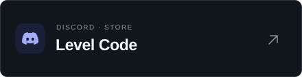

  
  &nbsp;
  

  

---

### 🚀 About Me & What I Do

* 🏢 **Founder of Experience Group:** Creating and developing FiveM servers.
* 🏢 **Founder of [Level Code](https://discord.gg/4bhhMhSHaY):** Custom systems and resources for FiveM.
* ⚙️ **Back-end Development:** APIs, services, and scalable systems, with a focus on performance and robust architectures.
* 🌐 **Front-end & Client Development:** Web interfaces and native applications, with a focus on usability and integration.
* ⚙️ **Systems Development:** Custom solutions, from software architecture to integration with systems and hardware.

---

### 🛠️ Technologies & Stack

<strong>Languages:</strong>

<table>
  <tr>
    <td></td>
    <td></td>
    <td></td>
  </tr>
</table>

<strong>Web & Ecosystem:</strong>

<table>
  <tr>
    <td></td>
    <td></td>
    <td></td>
    <td></td>
    <td></td>
    <td></td>
    <td></td>
  </tr>
</table>

<strong>3D & FiveM:</strong>

<table>
  <tr>
    <td></td>
    <td></td>
    <td></td>
  </tr>
</table>

<strong>Environments & Tools:</strong>

<table>
  <tr>
    <td></td>
    <td></td>
  </tr>
</table>

---

### 🐍 WHIT · Pixel Art

  

---

### 💬 Contact

<table align="center" width="100%">
  <tr>
    <td align="center" width="50%">
      
    </td>
    <td align="center" width="50%">
      
    </td>
  </tr>
</table>

Add me on Discord: @<code>.gusp_</code>

