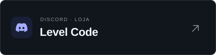
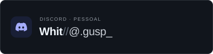

  
  &nbsp;
  

  

---

### 🚀 Sobre Mim & Áreas de Atuação

* 🏢 **Fundador da Experience Group:** Criação e desenvolvimento de servidores FiveM.
* 🏢 **Fundador da [Level Code](https://discord.gg/4bhhMhSHaY):** Sistemas e recursos personalizados para FiveM.
* ⚙️ **Desenvolvimento Back-end:** APIs, serviços e sistemas escaláveis, com foco em desempenho e arquiteturas robustas.
* 🌐 **Desenvolvimento Front-end & Cliente:** Interfaces web e aplicações nativas, com foco em usabilidade e integração.
* ⚙️ **Desenvolvimento de Sistemas:** Soluções sob medida, da arquitetura de software à integração com sistemas e hardware.

---

### 🛠️ Tecnologias & Stack

<strong>Linguagens:</strong>

<table>
  <tr>
    <td></td>
    <td></td>
    <td></td>
  </tr>
</table>

<strong>Web & Ecossistema:</strong>

<table>
  <tr>
    <td></td>
    <td></td>
    <td></td>
    <td></td>
    <td></td>
    <td></td>
    <td></td>
  </tr>
</table>

<strong>3D & FiveM:</strong>

<table>
  <tr>
    <td></td>
    <td></td>
    <td></td>
  </tr>
</table>

<strong>Ambientes & Ferramentas:</strong>

<table>
  <tr>
    <td></td>
    <td></td>
  </tr>
</table>

---

### 🐍 WHIT · Pixel Art

  

---

### 💬 Contato

<table align="center" width="100%">
  <tr>
    <td align="center" width="50%">
      
    </td>
    <td align="center" width="50%">
      
    </td>
  </tr>
</table>

Para adicionar no Discord: @<code>.gusp_</code>

